# Monitoreo de equipos Cisco con Zabbix, DHCP y SNMP

## 🎥 Video demostrativo

**[▶ Ver demostración de Zabbix, DHCP y SNMP en YouTube](https://youtu.be/WHTfUsrqivY)**

El video muestra la topología en GNS3, las comprobaciones de DHCP y SNMP en Cisco y el monitoreo de R1, SW1 y SW2 desde Zabbix.

**[📄 Ver informe PDF con todas las evidencias](Documentacion_Zabbix_SNMP_Oliver_Eliam_Aquino_Paulino.pdf)**

**Estudiante:** Oliver Eliam Aquino Paulino  
**Matrícula:** 2024-1571  
**Asignatura:** Seguridad de Redes  
**Fecha de práctica:** 1 de noviembre de 2026  
**Entorno:** GNS3 · Cisco 7200 · Cisco IOSvL2 · Zabbix Appliance 7.0.32 · Rocky Linux 8.10 · VMware

## Descripción

Implementación de una red LAN virtual de laboratorio en GNS3, integrada por el router **R1**, dos switches administrables **SW1 y SW2**, y un servidor **Zabbix**. El router ofrece DHCP a la LAN; los tres Cisco utilizan una comunidad **SNMPv2c de solo lectura**, y Zabbix obtiene una dirección dinámica para consultar disponibilidad, interfaces y tráfico.

**Resultado verificado:** R1, SW1 y SW2 aparecen con disponibilidad SNMP en verde en el panel de Zabbix; se observan métricas de ICMP, estado de interfaces y tráfico en **Monitoring → Latest data**.

## Objetivos

1. Configurar IP en R1, SW1 y SW2.
2. Configurar DHCP para la LAN en R1.
3. Establecer una comunidad SNMP de **solo lectura** en los tres equipos Cisco.
4. Obtener dirección IP dinámica en el servidor Zabbix.
5. Agregar los equipos Cisco a Zabbix y comprobar los valores recopilados por SNMP.

## Topología física de GNS3

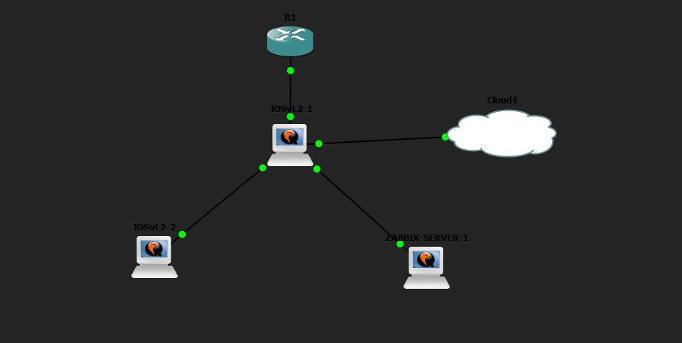

*Figura 1. Topología implementada en GNS3: R1, SW1, SW2, Zabbix y Cloud.*

~~~mermaid
flowchart TB
  R1["R1 · Router Cisco Fa0/0 · 10.15.71.1/24 DHCP y SNMP RO"]
  SW1["SW1 · IOSvL2 Vlan1 · 10.15.71.2/24"]
  SW2["SW2 · IOSvL2 Vlan1 · 10.15.71.3/24"]
  ZBX["ZABBIX-SERVER eth0 · 10.15.71.100/24 DHCP"]
  CL["Cloud1 · acceso desde Windows VMware VMnet2"]
  R1 ---|"Fa0/0 ↔ Gi0/0"| SW1
  SW1 ---|"Gi0/1 ↔ Gi0/0"| SW2
  SW1 ---|"Gi0/2 ↔ eth0"| ZBX
  SW1 ---|"Gi0/3 ↔ Cloud"| CL
~~~

El servidor Zabbix corre como QEMU VM dentro de GNS3. El Cloud conecta la topología con la red virtual del host Windows para acceder a la interfaz web. El adaptador de laboratorio reutilizado fue **VMnet2**.

## Direccionamiento

| Equipo | Interfaz | IP / máscara | Función |
|---|---|---|---|
| R1 | FastEthernet0/0 | `10.15.71.1/24` | Gateway y DHCP |
| SW1 | Vlan1 | `10.15.71.2/24` | Administración SNMP |
| SW2 | Vlan1 | `10.15.71.3/24` | Administración SNMP |
| ZABBIX-SERVER | eth0 | `10.15.71.100/24` (DHCP) | Monitoreo de Cisco |
| LAN | — | `10.15.71.0/24` | Subred del laboratorio |

El DHCP dispone de direcciones **.100 a .200**: en R1 se excluyeron .1–.99 y .201–.254.

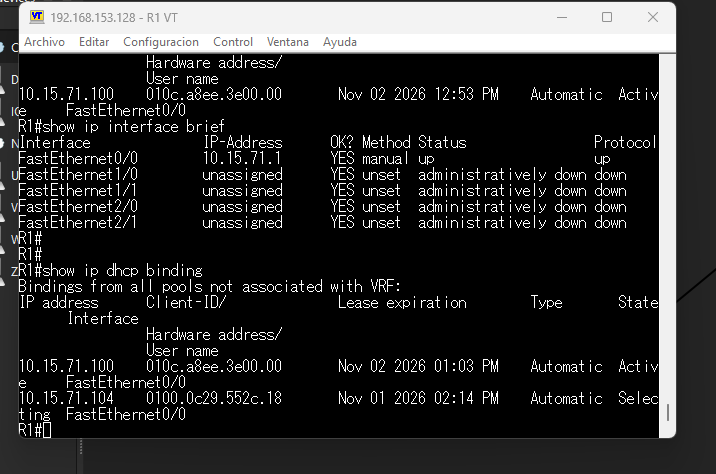

*Figura 2. Asignación de direcciones mediante DHCP en R1.*

## Configuración del router R1

~~~cisco
hostname R1
interface FastEthernet0/0
 description HACIA-SW1
 ip address 10.15.71.1 255.255.255.0
 duplex full
ip dhcp excluded-address 10.15.71.1 10.15.71.99
ip dhcp excluded-address 10.15.71.201 10.15.71.254
ip dhcp pool LAN_ZABBIX
 network 10.15.71.0 255.255.255.0
 default-router 10.15.71.1
snmp-server community ZABBIXRO71 RO
snmp-server location LABORATORIO-GNS3
snmp-server contact Oliver
~~~

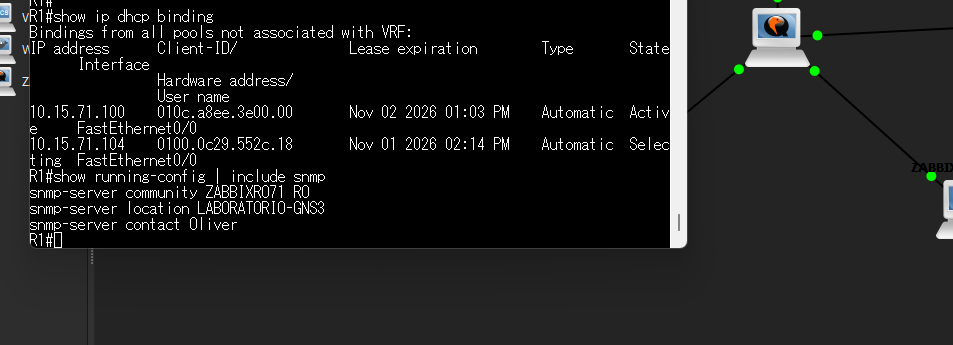

*Figura 3. Comunidad SNMP de solo lectura y verificación DHCP en R1.*

La salida real de `show ip dhcp binding` contiene la concesión `10.15.71.100` **Automatic / Active** para Zabbix. También aparece `10.15.71.104` con estado **Selecting**, no confirmada como concesión activa.

## Configuración de SW1 y SW2

Los switches emplean **VLAN 1** para administración y **GigabitEthernet** para sus enlaces.

| Equipo | Puerto | Conecta a |
|---|---|---|
| SW1 | Gi0/0 | R1 |
| SW1 | Gi0/1 | SW2 |
| SW1 | Gi0/2 | Zabbix |
| SW1 | Gi0/3 | Cloud |
| SW2 | Gi0/0 | SW1 |

~~~cisco
! SW1
interface Vlan1
 ip address 10.15.71.2 255.255.255.0
ip default-gateway 10.15.71.1
snmp-server community ZABBIXRO71 RO

! SW2
interface Vlan1
 ip address 10.15.71.3 255.255.255.0
ip default-gateway 10.15.71.1
snmp-server community ZABBIXRO71 RO
~~~

### Configuración de los switches

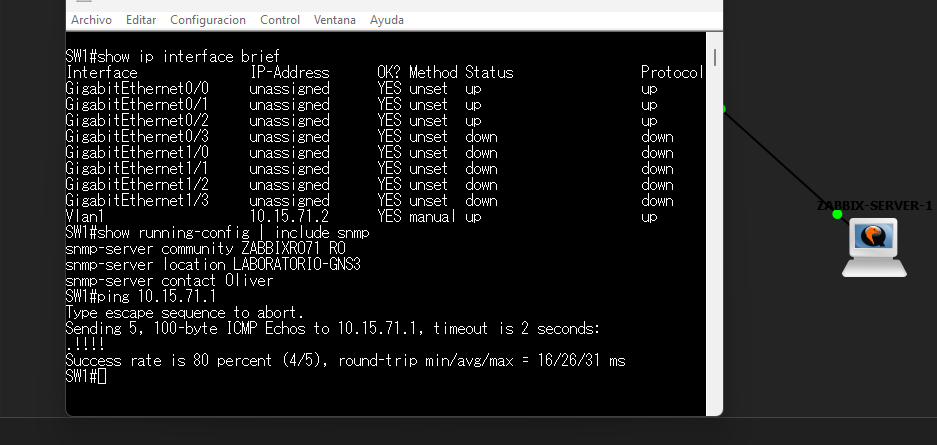

*Figura 4. VLAN 1, interfaces GigabitEthernet y SNMP en SW1.*

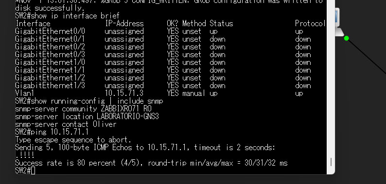

*Figura 5. Direccionamiento, enlace al switch principal y SNMP en SW2.*

### Running-config sanitizados

- [R1](running-configs/R1_running-config_SANITIZADO.txt)
- [SW1](running-configs/SW1_running-config_SANITIZADO.txt)
- [SW2](running-configs/SW2_running-config_SANITIZADO.txt)

Son **extractos reales** de los running-config compartidos para esta práctica, no copias completas de recuperación. Se eliminaron hashes de credenciales y banners.

## Zabbix 7.0.32

El servidor Zabbix Appliance utiliza Rocky Linux 8.10 y su interfaz `eth0` recibió una IP dinámica. La consola mostró:

~~~text
inet 10.15.71.100/24 scope global dynamic eth0
default via 10.15.71.1 dev eth0
~~~

`nginx` y `zabbix-server` respondieron `active`. La comunicación desde Zabbix a `10.15.71.1`, `10.15.71.2` y `10.15.71.3` respondió por ICMP.

### Evidencias del servidor y los hosts

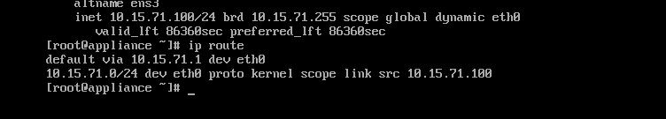

*Figura 6. El servidor Zabbix recibió 10.15.71.100 mediante DHCP.*

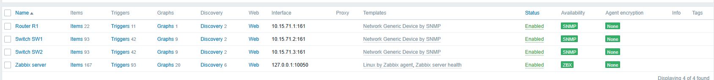

*Figura 7. Disponibilidad SNMP en verde para R1, SW1 y SW2.*

## Flujo de DHCP y consultas SNMP

~~~mermaid
sequenceDiagram
  participant Z as Zabbix eth0
  participant R as R1
  participant S1 as SW1
  participant S2 as SW2
  Z->>R: DHCP Discover / Request
  R-->>Z: IP 10.15.71.100/24 · gateway 10.15.71.1
  Z->>R: SNMPv2c UDP/161 · solo lectura
  R-->>Z: Información y estado de interfaces
  Z->>S1: SNMPv2c UDP/161 · solo lectura
  S1-->>Z: Estado y tráfico Gi
  Z->>S2: SNMPv2c UDP/161 · solo lectura
  S2-->>Z: Estado y tráfico Gi
~~~

En **Data collection → Hosts** se registraron los tres equipos dentro de `Laboratorio Cisco`, con interfaz SNMPv2, puerto **161**, comunidad `ZABBIXRO71` y plantilla **Network Generic Device by SNMP**.

| Host | Dirección SNMP | Indicador | Ítems configurados |
|---|---|---|---|
| Router R1 | 10.15.71.1:161 | SNMP verde | 22 |
| Switch SW1 | 10.15.71.2:161 | SNMP verde | 93 |
| Switch SW2 | 10.15.71.3:161 | SNMP verde | 93 |

**208 ítems** asociados a esos tres hosts en la captura de la práctica.

## Comprobación de resultados

| Prueba | Resultado observado |
|---|---|
| IP DHCP en Zabbix | `10.15.71.100/24` con marca `dynamic` |
| Router como servidor DHCP | Concesión `10.15.71.100` en estado **Automatic Active** |
| Ping desde Zabbix | R1, SW1 y SW2 responden |
| Servicios Zabbix | `nginx` y `zabbix-server` activos |
| Disponibilidad Zabbix | SNMP verde en R1, SW1 y SW2 |
| Latest data | ICMP, estado de interfaz, tráfico y velocidad |
| Pérdida ICMP | 0 % en los tres hosts, en captura de monitoreo |
| R1 Fa0/0 | Enlace `up`, 100 Mbps, full duplex |

Los datos de tráfico mostrados en `Latest data` dependen del instante de consulta y no son valores constantes.

### Métricas y tráfico observados en Zabbix

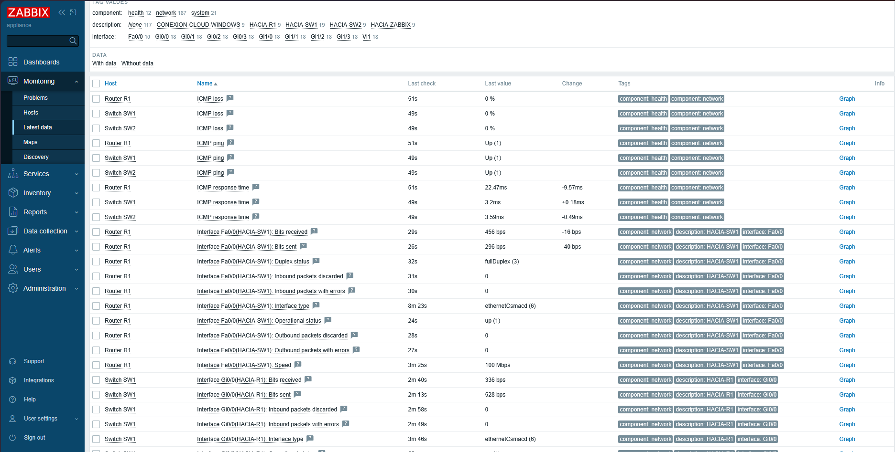

*Figura 8. Valores ICMP y métricas recopiladas de las interfaces mediante SNMP.*

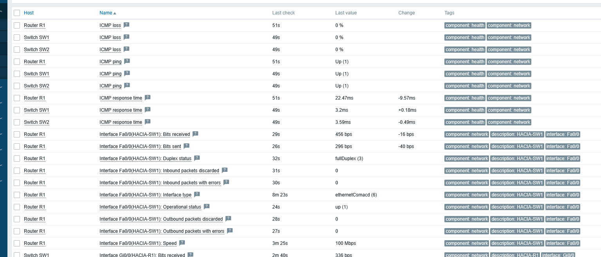

*Figura 9. Información de disponibilidad, tráfico, estado de puertos y velocidad.*

### Más evidencias de la práctica

Ver capturas adicionales de pruebas y conectividad

**Consola Linux de Zabbix: servicios, DHCP y pruebas**

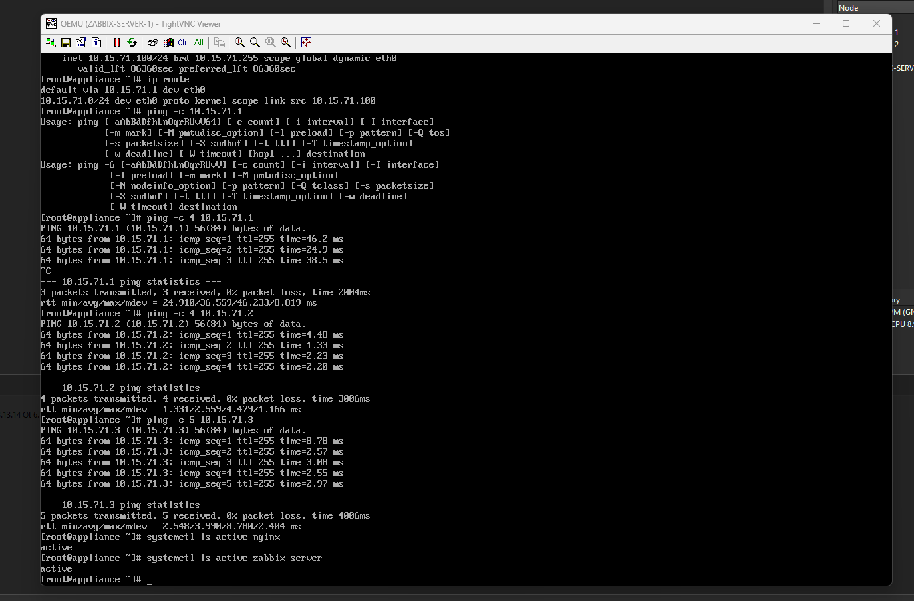

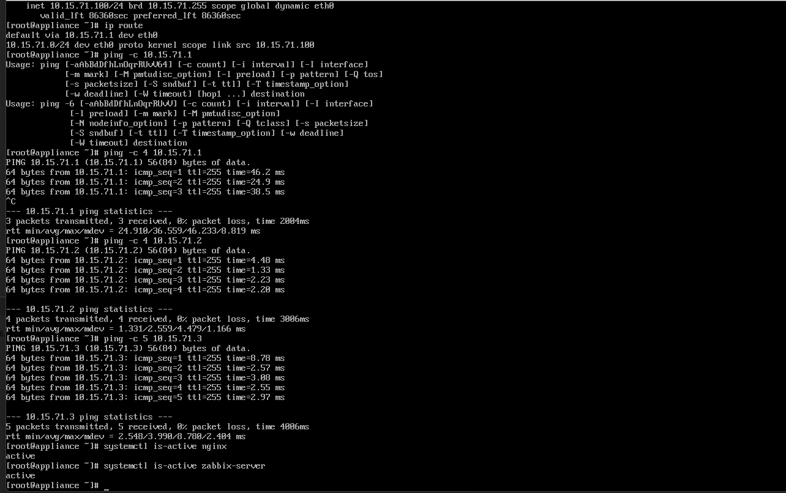

**Listado de equipos supervisados**

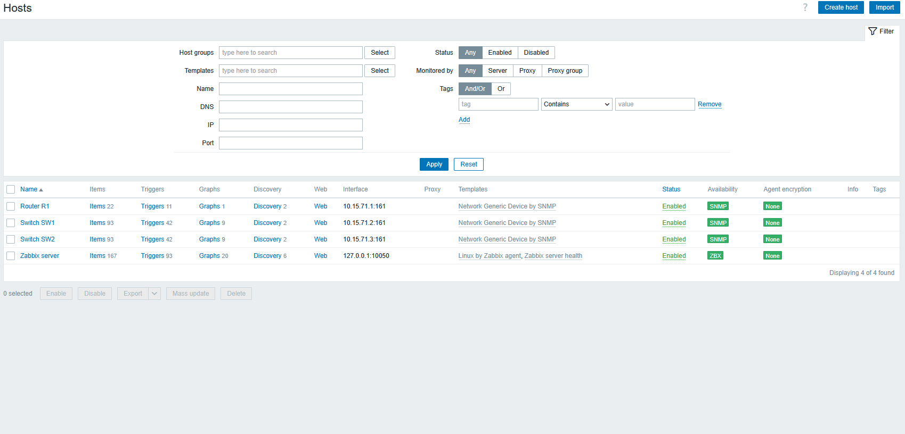

**Conexión del Cloud con VMware VMnet2**

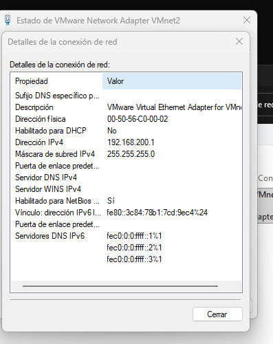

## Documentos del repositorio

- [📄 Informe completo en PDF](Documentacion_Zabbix_SNMP_Oliver_Eliam_Aquino_Paulino.pdf)
- [📷 Galería de capturas y evidencias](docs/Lista_de_evidencias.md)
- [Informe técnico y descripción de evidencias](docs/Informe_tecnico_Zabbix.md)
- [Comandos de comprobación](scripts/Comandos_de_verificacion.md)
- [Running-config de R1](running-configs/R1_running-config_SANITIZADO.txt)
- [Running-config de SW1](running-configs/SW1_running-config_SANITIZADO.txt)
- [Running-config de SW2](running-configs/SW2_running-config_SANITIZADO.txt)
- [Listado de capturas de la práctica](docs/Lista_de_evidencias.md)

## Seguridad

Esta práctica está diseñada para una red virtual de laboratorio. **SNMPv2c no cifra las comunidades**, por lo que en entornos de producción conviene emplear SNMPv3, restricciones de origen y credenciales diferentes. El material público omite secretos de administración de Cisco. No se declara configuración de alertas o notificaciones, porque no formó parte de los requisitos evaluados.

## Conclusión

El laboratorio demuestra direccionamiento IP y DHCP en R1, administración de switches por VLAN 1 y recolección funcional de métricas SNMP desde Zabbix. La dirección dinámica asignada, el estado SNMP verde y las métricas de red confirman los objetivos de la práctica.
