# Capturas del laboratorio Zabbix y SNMP

**Práctica individual — Oliver Eliam Aquino Paulino · 2024-1571**

Se presentan capturas de la topología, las comprobaciones de DHCP, el monitoreo SNMP y las pruebas efectuadas con los tres equipos Cisco.

## Topología

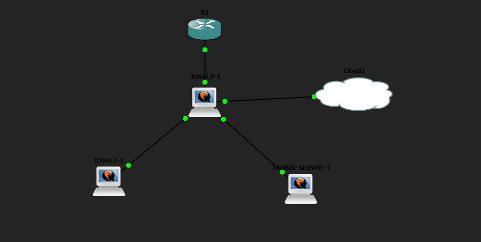

## Router R1: DHCP y SNMP

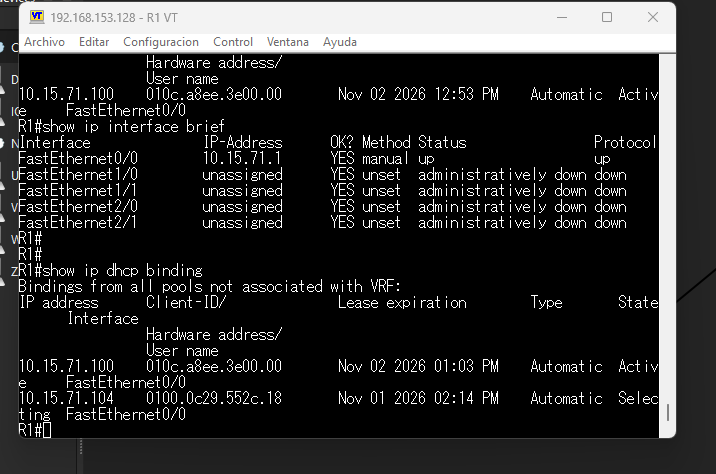

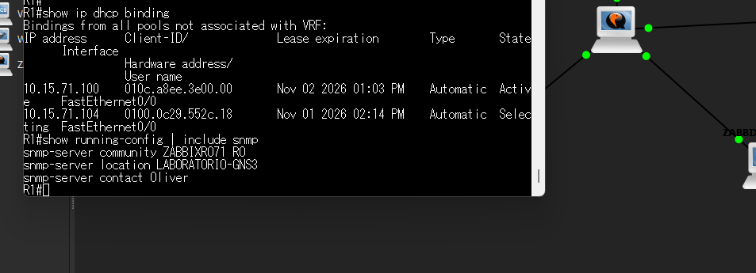

## SW1 y SW2

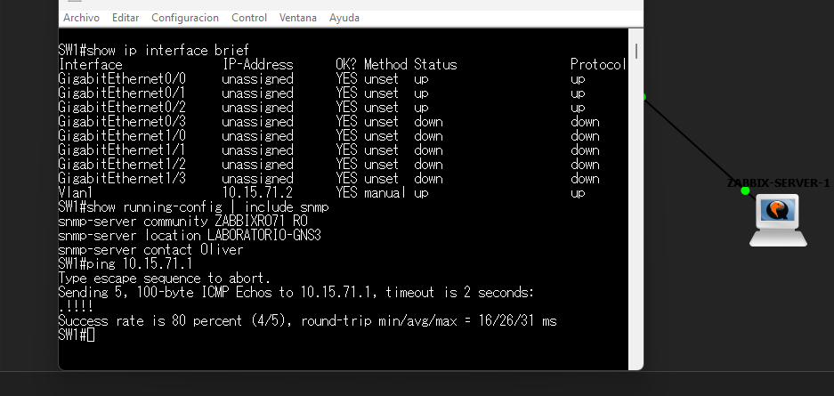

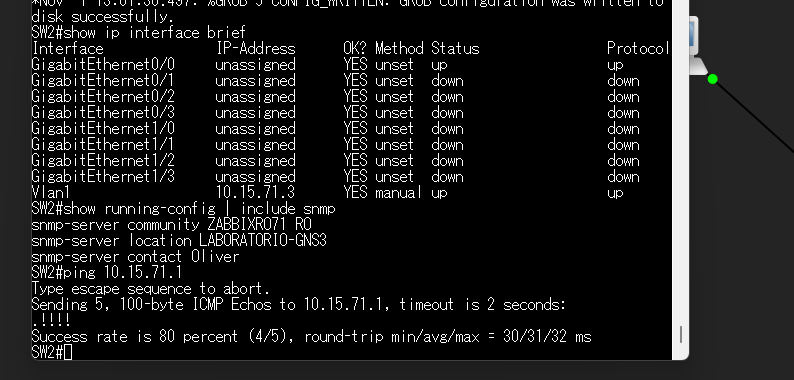

## Servidor Zabbix con DHCP

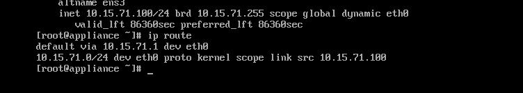

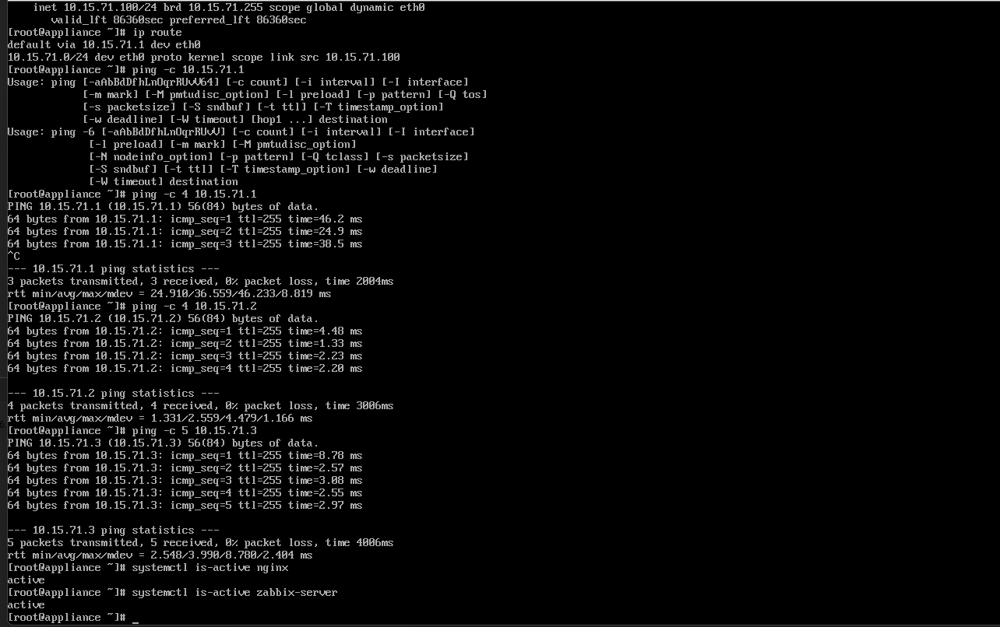

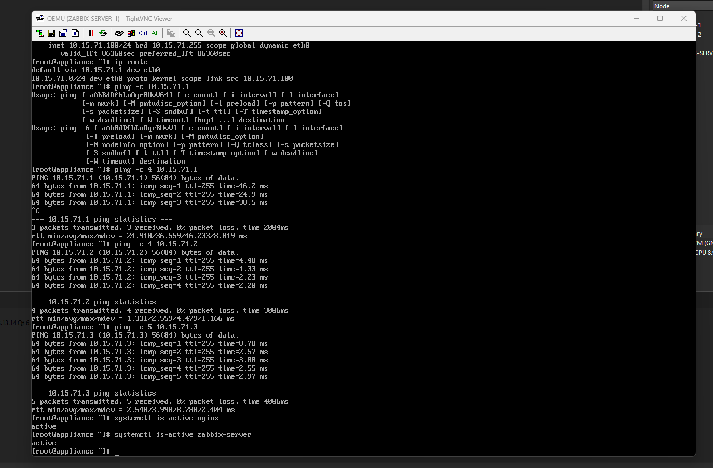

## Monitoreo SNMP

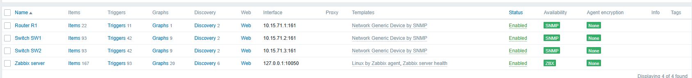

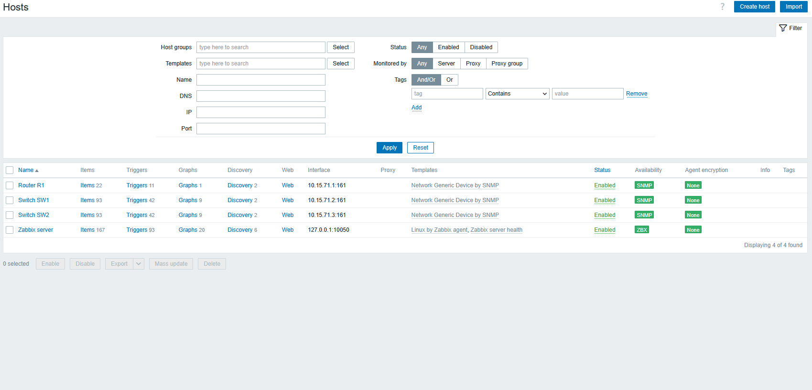

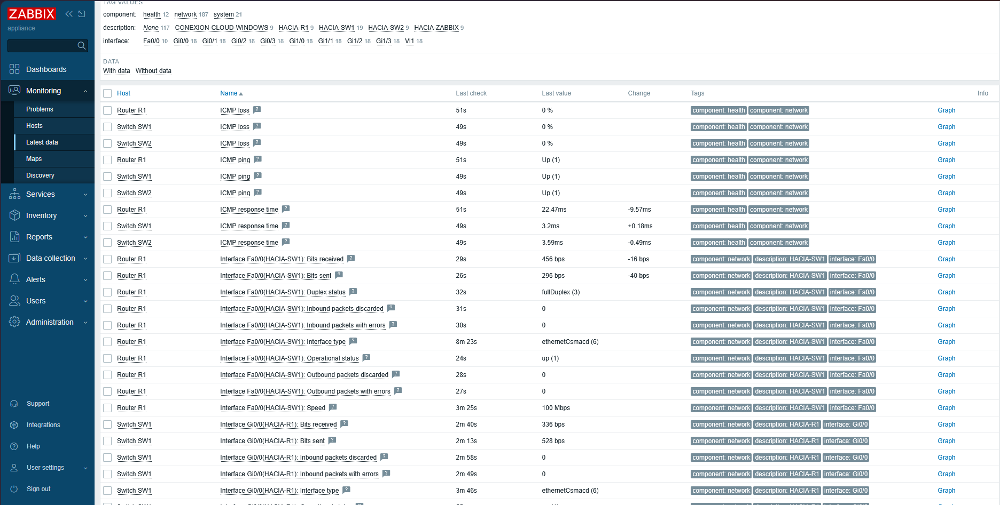

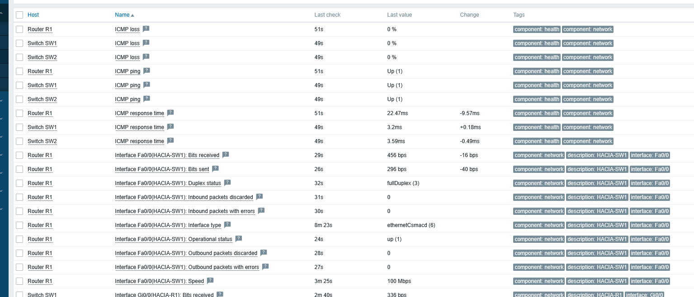

## Conexión del host Windows

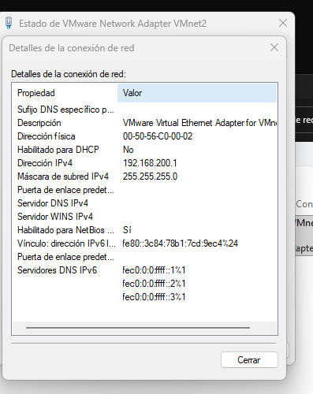

## Documento

[Ver PDF de la práctica](../Documentacion_Zabbix_SNMP_Oliver_Eliam_Aquino_Paulino.pdf)
